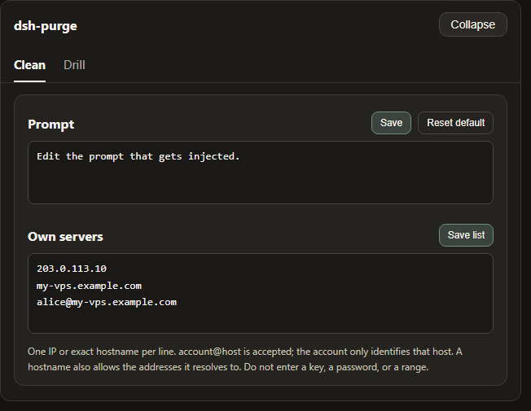
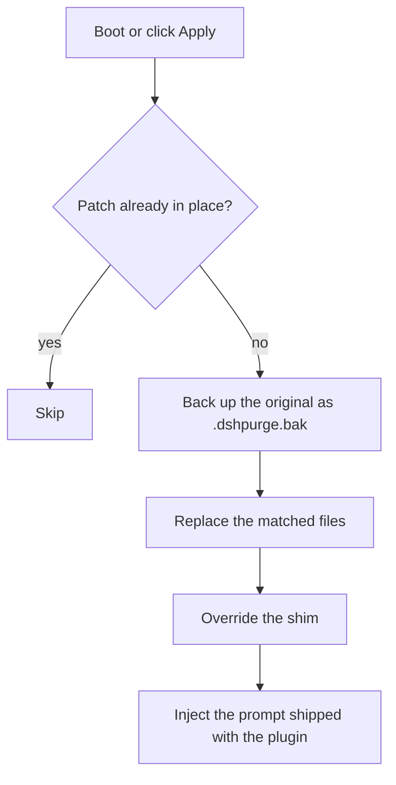
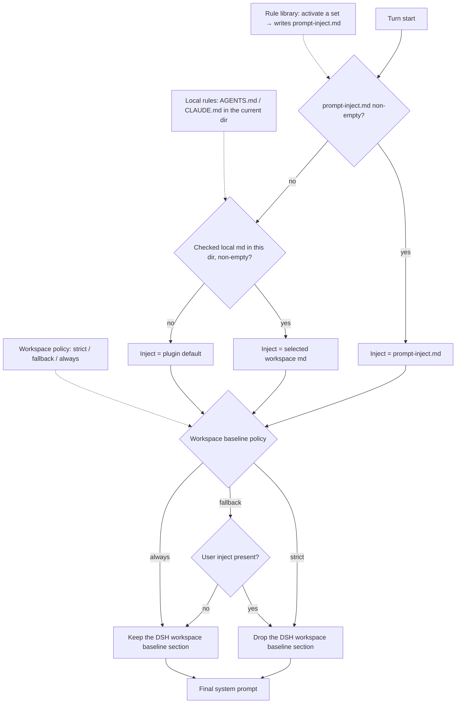

<p align="center">
  
</p>

<h1 align="center">dsh-purge</h1>

<p align="center"><strong>DeepSeek Harness local security-eval &amp; prompt-cleaning plugin</strong></p>

<p align="center"><strong>Version 1.2.3</strong></p>

<p align="center">
  <a href="https://github.com/chs-1108/dsh-purge/stargazers"></a>
  <a href="LICENSE"></a>
  <a href="https://www.deepseek.com/harness/"></a>
  = 18">
  
</p>

<p align="center">
  <a href="README.md">English</a> | <a href="README.zh-CN.md">中文</a>
</p>

> **What it is, in one line:** a local plugin for the DeepSeek Harness you already run. It gives you a side dock to see and adjust the harness's own prompt layers, approval policy, and tool limits — plus a prompt/rule-set manager and a separate drill console for authorized red-team work on hosts you control.

> **Not a model wrapper.** Harness rewrites prompts, gates approvals, and enforces sandbox policy at runtime. "The model refused" and "the host blocked it" look identical from the outside. This plugin separates those two layers on your own install, so you can tell which one you are looking at.

---

## Contents

- [Features](#features)
- [Requirements](#requirements)
- [Install](#install)
- [Quick start](#quick-start)
- [Screenshots](#screenshots)
- [Usage](#usage)
- [Configuration](#configuration)
- [Runtime files](#runtime-files)
- [How it works](#how-it-works)
- [Restore &amp; uninstall](#restore--uninstall)
- [Troubleshooting](#troubleshooting)
- [Project structure](#project-structure)
- [Development](#development)
- [Attribution](#attribution)
- [Disclaimer](#disclaimer)
- [License](#license)

---

## Features

| Feature | What it does |
|---|---|
| **Side dock** | A `dsh-purge` button next to the session title opens a right-hand panel with two pages: **Clean** and **Drill**. Light / Ink themes |
| **Patch status** | Every host-layer patch is listed with its real state (`applied` / `pending` / `skipped` / `missing_file`), grouped by area. Counts only include what actually applied |
| **Apply / Restore / Uninstall** | One click each. Apply is idempotent and backs up originals first; Restore puts the originals back; Uninstall reverts then removes the plugin |
| **Prompt injection** | Edit `prompt-inject.md` in the dock, or keep several rule sets and switch between them. Injection is re-applied every turn, so a new chat never starts half-clean |
| **Rule sets** | Multiple `AGENTS.md` / `CLAUDE.md` profiles under `$DSH_HOME`. Enable writes the file, Delete removes the row |
| **Workspace policy** | `strict` / `fallback` / `always` — decides whether the harness's own workspace baseline section survives alongside your prompt |
| **Own servers** | A whitelist (`$DSH_HOME/net-scope-allow.txt`) of exact IPs / hostnames that are yours. Anything not listed stays out of scope |
| **Skills** | Import a zip or folder into the host's own `$DSH_HOME/skills/<id>/SKILL.md`. DSH keeps ownership of matching, loading, and `/name` |
| **Rewind** | Composer "Undo once" / "Undo last round" and `/rewind`, built on the official `session.fork({ atSeq })` |
| **Self-check on start** | After `npm`/`pnpm` rewrites `node_modules`, the plugin notices and re-applies instead of asking you to hand-edit files |
| **Drill console** | A separate page for assets, skills, and environment checks. Gated behind a notice + countdown + three checkboxes. Only for hosts you manage or offline/authorized targets |

No hardcoded drive letters. Home resolution order: `$DSH_HOME` → `.dsh` next to the dsh launcher → `~/.dsh`.

---

## Requirements

| Item | Requirement |
|---|---|
| Host | Official **DeepSeek Harness 0.2.x** — `dsh web` **and** the official desktop EXE (each has its own profile; install and Apply separately) |
| Node.js | **≥ 18** |
| OS | Windows, macOS, Linux |
| Privileges | Write access to `$DSH_HOME` and to the installed `@deepseek-ai/*` packages |

Older hosts (dsh 0.1.x) are not supported by this line — unmatched patches would stay `pending` or `skipped`, nothing is rewritten blindly.

---

## Install

### Option 1 — one command (recommended)

Install from this repository straight into a profile:

```sh
# Web (official `dsh web`)
dsh plugin --profile web add https://github.com/chs-1108/dsh-purge.git

# Desktop (official EXE)
dsh plugin --profile desktop add https://github.com/chs-1108/dsh-purge.git
```

### Option 2 — tarball / zip

```sh
# tarball, no git required
dsh plugin --profile web add https://github.com/chs-1108/dsh-purge/archive/refs/heads/main.tar.gz
dsh plugin --profile desktop add https://github.com/chs-1108/dsh-purge/archive/refs/heads/main.tar.gz
```

Or download the zip from [Releases](https://github.com/chs-1108/dsh-purge/releases) (or **Code → Download ZIP**), then follow **Option 4**.

### Option 3 — clone into the plugin directory

```sh
git clone https://github.com/chs-1108/dsh-purge.git "$DSH_HOME/plugins/dsh-purge"
```

The folder must be named `dsh-purge` and contain a `package.json` whose `"name"` is `dsh-purge`. Copy the whole tree — not a handful of `.js` files.

### Option 4 — manual profile edit

Use this when the command fails or `dsh` is not on PATH. Edit **only the profile of the host you actually run**.

1. **Put the plugin at `$DSH_HOME/plugins/dsh-purge`** (see Option 3, or extract the zip and rename `dsh-purge-master` → `dsh-purge`).

2. **Back up, then edit that profile's `package.json`.** Add exactly two things and keep every existing entry:

```json
{
  "name": "dsh-profile-web",
  "private": true,
  "dependencies": {
    "dsh-purge": "file:../../plugins/dsh-purge"
  },
  "dsh": {
    "profile": {
      "bundles": [
        "@deepseek-ai/dsh-base",
        "@deepseek-ai/dsh-web-app",
        "dsh-purge"
      ]
    }
  }
}
```

`dsh-purge` must appear in **both** `dependencies` and the **end** of `dsh.profile.bundles`. A dependency without the bundle entry installs the files but never loads the plugin.

3. **Install dependencies in that profile only:**

```sh
cd "$DSH_HOME/profiles/web"   # or profiles/desktop
pnpm install
```

Success looks like `profiles/<web|desktop>/node_modules/dsh-purge/package.json` existing.

### After installing: three steps

Adding the plugin to a profile does **not** patch the harness by itself.

1. **Fully quit and reopen** that host — stop and restart `dsh web`, or quit the desktop tray and reopen the app.
2. On **that host**, click **dsh-purge** next to the session title → **Clean** → **Apply**.
3. A successful Apply restarts the host once so the patched packages load. An unfinished Apply does not restart.

Web controls affect Web only; desktop controls affect the desktop app only. Do not Apply one host from the other.

### How to tell it worked

- The `dsh-purge` button sits beside the session title, and **Apply** is on its Clean page.
- `/purge status` in chat prints `DSH_HOME` and the patch table — the path should be the home you actually run.
- Optional packages you do not have (e.g. the `liangshen` preset) show as `skipped` and do not block Apply.

---

## Quick start

```sh
# 1. check what the plugin sees
/purge status

# 2. write the patches
/purge apply

# 3. restart the host, then start a new chat
```

From a terminal instead of chat: `dsh-purge --status`, `--apply`, `--revert`, `--uninstall`, `--edit`.

---

## Screenshots

**Clean** — patches, prompt, rule sets, skills


**Drill authorization** — read the notice, wait out the countdown, tick three boxes


**Drill** — assets, skills, environment


**Patches** — grouped status, Apply / Restore / Uninstall


**Own servers** — one host per line, then Save list



---

## Usage

### Chat commands

```
/purge  status | apply | revert | uninstall | edit | help
/rules  list | use <id> | create <id> | delete <id> | reset | help
/skills list | import <zip-or-folder> | create <id> [description] | delete <id> | help
/rewind
```

### CLI

```sh
dsh-purge --status      # state, DSH_HOME, per-patch table
dsh-purge --apply       # apply every patch (prompt + code + shim + override)
dsh-purge --revert      # restore originals
dsh-purge --uninstall   # revert if needed, then remove the plugin
dsh-purge --edit        # open prompt-inject.md in $EDITOR
dsh-purge --help
```

### Tools exposed to the model

| Tool | Purpose |
|---|---|
| `purge_status` | Read patch state, `DSH_HOME`, injection source |
| `purge_apply` | Apply all patches |
| `purge_revert` | Restore originals |

### Where things live in the dock

| Area | What it shows |
|---|---|
| **dsh-purge** | Button beside the session title; opens or collapses the dock |
| **Clean** | Patches, prompt editor, rule sets, skills, own servers |
| **Drill** | Assets, skills, environment — says *Unauthorized* until the gate is passed |
| **Patches** | Grouped status plus Apply / Restore / Uninstall |
| **Prompt** | Edits `prompt-inject.md`, the per-session override |
| **Own servers** | One IP or exact hostname per line → `$DSH_HOME/net-scope-allow.txt` |
| **Rule sets** | Multiple `AGENTS.md` / `CLAUDE.md`; Enable writes, Delete removes |
| **Skills** | Import a zip/folder into this host's `$DSH_HOME/skills/<id>/SKILL.md` |

---

## Configuration

Plugin config lives in the profile's `cordis.patch.yml` (or the copy bundled in `cordis.patch.yml` at the repo root). Defaults:

```yaml
- insert:
    - id: dsh-purge
      name: 'dsh-purge'
      inject: [systemPrompt, tools]
      config:
        enabled: true
        autoApplyOnStart: false     # apply patches when the host boots
        autoUpdateOnStart: false    # check this repo for a newer version on boot
        autoRevertOnMissing: false  # revert when the host files disappear
        injectOnce: false           # inject only on the first turn
        stripMnemon: true           # drop mnemon sections from the assembly
        verbose: false              # verbose logging to the console
        postPrompt: ""              # extra section appended to the prompt
        postPromptOrder: 5100
        autoRetry: true             # retry a failed turn
        retryMax: 3
        autoContinue: false         # auto-send a continue message
        continueMax: 3
        continueText: "继续"
        capabilityProtocol: true    # teach the model to find skills / MCP itself
        hooksDenyBypass: true       # neutralise hooks that block tool calls
```

| Key | Default | Notes |
|---|---|---|
| `enabled` | `true` | Master switch; `false` leaves the host untouched |
| `autoApplyOnStart` | `false` | Turn on only if you want boot-time patching |
| `autoUpdateOnStart` | `false` | Contacts this repo to compare versions |
| `stripMnemon` | `true` | Removes third-party mnemon sections from the assembly |
| `capabilityProtocol` | `true` | Adds the skill / MCP discovery section |
| `hooksDenyBypass` | `true` | Stops third-party hooks from silently denying tool calls |

Diagnostics are **off by default**. Set `DSH_PURGE_DEBUG=1` (or `verbose: true`) to write a log to `%TEMP%/.dsh-cache.log` (`$TMPDIR/.dsh-cache.log`).

---

## Runtime files

Everything the plugin owns lives under `$DSH_HOME`:

| Path | Purpose |
|---|---|
| `prompt-inject.md` | The prompt that gets injected each turn (a user file — Restore keeps it) |
| `rules/` | Rule sets (`AGENTS.md` / `CLAUDE.md` variants) |
| `skills/` | Imported skills, `skills/<id>/SKILL.md` |
| `net-scope-allow.txt` | The own-servers whitelist |
| `redteam/` | Drill console data (SQLite) |

Web and the desktop app each use their own home. Skills are not part of the injected section and never replace the prompt.

---

## How it works

**Apply** (on boot or when you click it):



**Every turn**, the injection source is decided in this order:



Two invariants the plugin maintains at assembly time:

- **No unregistered prompt variables escape.** The host's renderer throws on any `{{name}}` it did not register, which kills the whole request. Every section is passed through a guard that resolves `{{cwd}}` to the real path and degrades anything else to `{ {name}}`.
- **The injected text leads the assembly.** Later sections cannot outrank it by accident, and duplicate copies are removed by content match rather than position.

---

## Restore &amp; uninstall

- Each patched file is copied to `<file>.dshpurge.bak` before the first Apply.
- **Restore** / `/purge revert` copies backups back and deletes them. With no backup, shim lines written by this plugin are stripped.
- `prompt-inject.md` is a user file and is kept.
- **Uninstall** restores first (if anything was applied), then removes the inject file, rule library, and the plugin itself.
- Apply is idempotent — running it twice is safe.

```sh
dsh-purge --uninstall
# or: /purge uninstall
```

---

## Troubleshooting

**`unknown prompt variable "{{cwd}}" in section "deployment:persona-suffix"`**
You are on a host that removed `cwd` from its prompt-variable registry, with a plugin build that still wrote `{{cwd}}` into the persona suffix. Fixed in **1.2.0**. Upgrade, then fully restart the host — the plugin is loaded into memory at boot, so a live reload is not enough.

**The `dsh-purge` button never appears**
The plugin is installed but not enabled. Check that `dsh-purge` is in the **`dsh.profile.bundles`** array of the profile you actually run — a `dependencies` entry alone only copies files into `node_modules`. See [Option 4](#option-4--manual-profile-edit).

**`失败: 清洗没有写进全部宿主，已取消重启` / `cleaning was not written into every host, restart cancelled`**
The pre-restart gate found a host whose patch marker was missing. Fixed in **1.2.1** for hosts where the `assemble` source gained a `requiredContexts` line — patch #40 could not match, so its marker was never written and the gate refused forever. Upgrade, then Apply again. To confirm before restarting:

```sh
node scripts/verify-keep-inject.mjs   # read-only: does #40 match this host build?
node scripts/diagnose-hosts.mjs       # per-host markers + pending patches
```

If a patch is `skipped` on your build, retrying cannot write it — 1.2.1 no longer blocks the restart for that case and reports it as a warning instead.

**Apply finishes but nothing changes**
Patches load at boot. Quit the host completely (desktop: quit the tray, do not just close the window), reopen it, then Apply, then start a **new** chat.

**The same task works in standard but fails in minimal or PTC**
Preset-level `run_code` / sandbox / plan intercept text is often still in place, or the built-in minimal preset is missing `agent-instructions`. Update, then: fully quit → Apply in Clean → restart → new chat. Switching preset alone does not reload patches in a running process.

**A patch shows `missing_file`**
That host build does not contain the file the patch targets, or it is an optional package you do not have (e.g. `liangshen`). Optional rows are marked and do not block Apply. After a host upgrade, unmatched originals show as `skipped` and are left untouched.

**`dsh` is not on PATH**
Use [Option 4](#option-4--manual-profile-edit), or call the CLI shipped with the app. If the plugin cannot find the host at all, set `DSH_BASE` (or `DSH_DESKTOP_INSTALL`) to the directory containing `@deepseek-ai`. No files are changed when nothing is found.

---

## Project structure

```
dsh-purge/
├── bin/dsh-purge.js        CLI entry
├── lib/
│   ├── index.js            plugin entry: prompt sections, commands, tools
│   ├── core.js             patch table, apply / revert / backup
│   ├── identity.js         assembly rewrite, injection guard
│   ├── rules.js            rule sets, workspace policy
│   ├── skills.js           skill import
│   ├── net-scope.js        own-servers whitelist
│   ├── rewind.js           session fork / undo
│   ├── update.js           self-update from this repo
│   ├── redteam/            drill console (store, tools, ui, presets)
│   └── …
├── presets/redteam/        red-team agent preset
├── skills/redteam/         bundled skills
├── scripts/                build + self-check helpers
├── client.js               the dock (built bundle)
├── cordis.patch.yml        bundle patch: what the profile loads
└── docs/                   banner, previews
```

---

## Development

```sh
# syntax check every entry
node --check lib/index.js
node --check lib/core.js
node --check lib/reapply.js
node --input-type=module -e "import('./lib/index.js')"

# read-only self-check: patch table shape + real settle state
node scripts/selftest.mjs

# dry run: which files would change, whether it stays idempotent
node scripts/simulate-upgrade.mjs

# verify no unregistered prompt variable can reach the renderer
node scripts/verify-cwd-suffix.mjs [plugin-dir]

# does patch #40 still match this host build? (read-only)
node scripts/verify-keep-inject.mjs [host-index.js]

# which host is missing a clean marker, and which patches are pending (read-only)
node scripts/diagnose-hosts.mjs

# replay the write step + the pre-restart gate without restarting
node scripts/check-ensure-clean.mjs

# every patched host file parses, and the extracted tree matches app.asar 1:1
node scripts/verify-host-tree.mjs <app.asar> <resources/app>
node scripts/asar-ls.mjs <app.asar> dsh/node_modules/@deepseek-ai --count

# rebuild the dock bundle
node scripts/build-client.mjs
```

Release flow: bump `package.json`, write Chinese **and** English notes in `release-notes.md` (first line must be `# <version>`), push `main`. The workflow creates the tag, the GitHub Release, and the zip.

---

## Attribution

This project is derived from **[YuJunZhiXue/dsh-purge](https://github.com/YuJunZhiXue/dsh-purge)** (MIT). The patch table, drill console, presets, and skills originate there; this repository carries local fixes and changes on top of it.

If you reuse this project's name, ideas, code, or prompts, credit the original author and link the upstream repository.

---

## Disclaimer

This is a free, non-profit open-source project for learning and research on **software you are entitled to administer**. It patches the official `@deepseek-ai` packages and local config **on your own machine only**; it does not scan, probe, or send traffic to third-party systems, and it ships no malware, backdoors, or attack payloads.

Do not use it for unauthorized access, data theft, sabotage, or anything unlawful. Do not point it at public systems, production workloads, or networks in mainland China, Hong Kong, or Macau unless that exact host was registered as yours in advance. You are solely responsible for how you use it; the authors accept no liability for misuse. The MIT license terminates automatically for anyone who uses the project to commit a crime.

This is an independent project with no employment, commercial, or endorsement relationship with DeepSeek. "Official" only ever means the eval target is the official Harness package on your own machine.

---

## License

[MIT](LICENSE)
