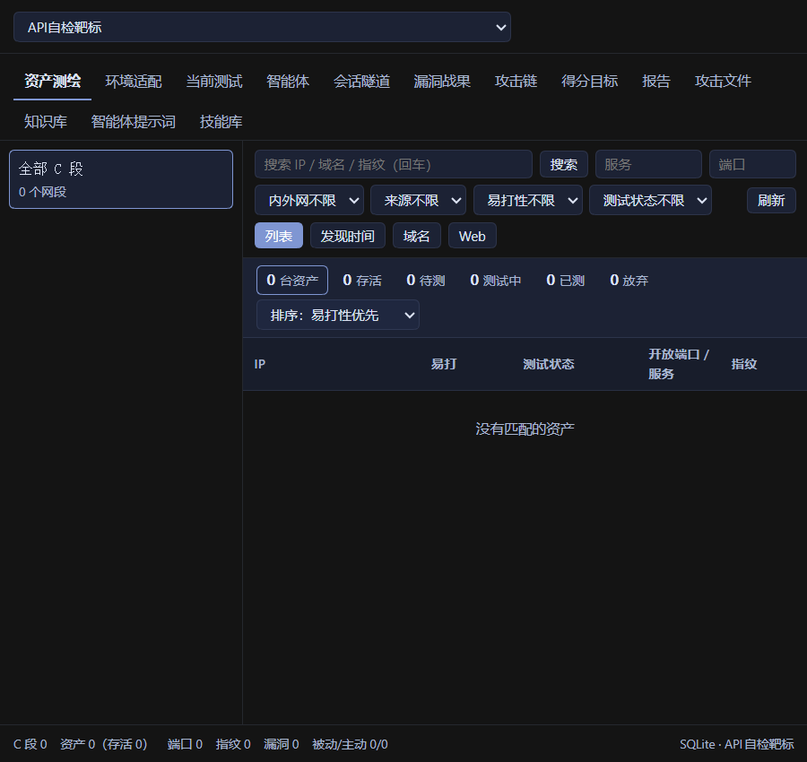
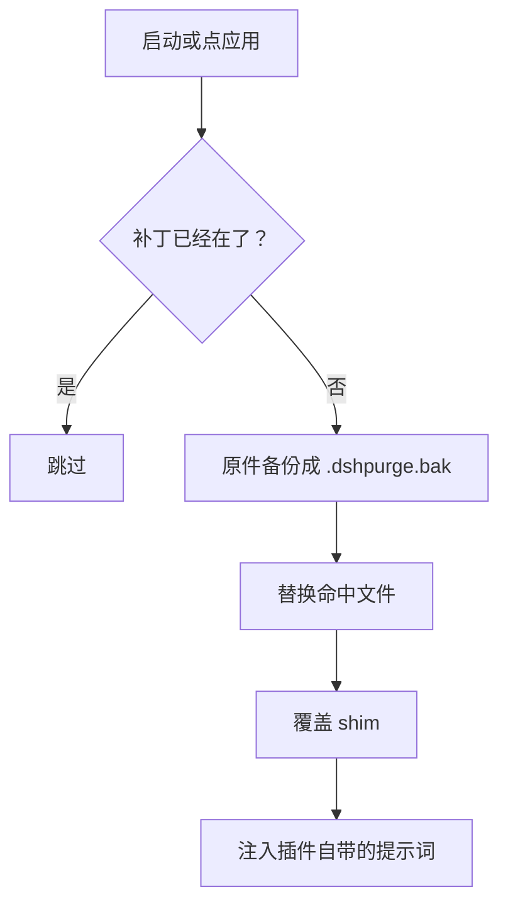
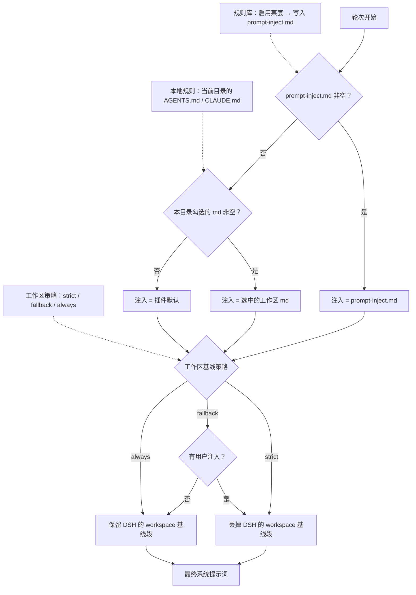

<p align="center">
  
</p>

<h1 align="center">dsh-purge</h1>

<p align="center"><strong>DeepSeek Harness 本机安全评测与提示词清洗插件</strong></p>

<p align="center"><strong>版本 1.2.3</strong></p>

<p align="center">
  <a href="https://github.com/chs-1108/dsh-purge/stargazers"></a>
  <a href="LICENSE"></a>
  <a href="https://www.deepseek.com/harness/"></a>
  = 18">
  
</p>

<p align="center">
  <a href="README.md">English</a> | <a href="README.zh-CN.md">中文</a>
</p>

> **一句话说明：** 这是给**你本机已经装好的 DeepSeek Harness** 用的插件。它在会话标题旁开一个侧栏，把宿主自己的提示词分层、审批策略、工具上限摊开给你看和改；另外带一套提示词 / 规则集管理，和一个独立的演练台（只在你管的机器、离线靶标或有书面授权的范围内用）。

> **它不包模型。** 宿主会在运行时改写提示词、卡审批、加沙箱策略。"模型拒绝了"和"宿主拦住了"从外面看是一回事。这个插件只在你自己的安装上把这两层拆开，让你知道看到的是哪一层。

---

## 目录

- [功能](#功能)
- [环境要求](#环境要求)
- [安装](#安装)
- [快速开始](#快速开始)
- [界面预览](#界面预览)
- [使用](#使用)
- [配置](#配置)
- [运行时文件](#运行时文件)
- [工作原理](#工作原理)
- [还原与卸载](#还原与卸载)
- [常见问题](#常见问题)
- [项目结构](#项目结构)
- [开发](#开发)
- [署名](#署名)
- [免责声明](#免责声明)
- [许可](#许可)

---

## 功能

| 功能 | 说明 |
|---|---|
| **侧栏面板** | 会话标题旁的 `dsh-purge` 按钮打开右侧栏，两页：**清洗** 和 **演练台**。浅色 / 墨色两套主题 |
| **补丁状态** | 每条宿主层补丁都显示真实状态（`applied` / `pending` / `skipped` / `missing_file`），按用途分组；计数只算真正打上的 |
| **应用 / 还原 / 卸载** | 各一个按钮。应用是幂等的，落盘前先备份；还原把原件放回；卸载先还原再清掉插件 |
| **提示词注入** | 面板里直接编辑 `prompt-inject.md`，或者建多套规则集切换。注入每轮都重新应用，新对话不会从"半清洗"状态开始 |
| **规则集** | 在 `$DSH_HOME` 下维护多套 `AGENTS.md` / `CLAUDE.md`。启用即写入，删除即移除该行 |
| **工作区策略** | `strict` / `fallback` / `always`——决定宿主自带的 workspace 基线段要不要跟你的提示词一起保留 |
| **自有服务器** | 一份白名单（`$DSH_HOME/net-scope-allow.txt`），逐条登记**精确 IP / 主机名**。没登记的仍然在范围外 |
| **技能** | zip 或文件夹导入到宿主自己的 `$DSH_HOME/skills/<id>/SKILL.md`。匹配、加载、`/名字` 仍归 DSH 管 |
| **回退一轮** | 输入框的"撤销一次" / "撤销上一轮" 和 `/rewind`，走官方 `session.fork({ atSeq })` |
| **启动自检** | `npm` / `pnpm` 把 `node_modules` 重写掉之后，插件会发现并重新打补丁，不用你手改文件 |
| **演练台** | 资产、技能、环境检查独立一页。要过提示 + 倒计时 + 三个勾选才解锁；只用于你管的机器或离线 / 授权靶标 |

没有写死的盘符。主目录解析顺序：`$DSH_HOME` → dsh 启动器旁的 `.dsh` → `~/.dsh`。

---

## 环境要求

| 项目 | 要求 |
|---|---|
| 宿主 | 官方 **DeepSeek Harness 0.2.x**——`dsh web` **和** 官方桌面 EXE（各有自己的 profile，要分别安装、分别应用） |
| Node.js | **≥ 18** |
| 系统 | Windows / macOS / Linux |
| 权限 | 对 `$DSH_HOME` 和已安装的 `@deepseek-ai/*` 包有写权限 |

0.1.x 老宿主不在本版本支持范围内——对不上的补丁只会显示 `pending` / `skipped`，不会盲改。

---

## 安装

### 方式一 —— 一条命令（推荐）

直接从本仓库装进 profile：

```sh
# Web（官方 `dsh web`）
dsh plugin --profile web add https://github.com/chs-1108/dsh-purge.git

# 桌面（官方 EXE）
dsh plugin --profile desktop add https://github.com/chs-1108/dsh-purge.git
```

### 方式二 —— tarball / zip

```sh
# tarball，不需要装 git
dsh plugin --profile web add https://github.com/chs-1108/dsh-purge/archive/refs/heads/main.tar.gz
dsh plugin --profile desktop add https://github.com/chs-1108/dsh-purge/archive/refs/heads/main.tar.gz
```

也可以从 [Releases](https://github.com/chs-1108/dsh-purge/releases) 下载 zip（或 **Code → Download ZIP**），再按**方式四**操作。

### 方式三 —— clone 到插件目录

```sh
git clone https://github.com/chs-1108/dsh-purge.git "$DSH_HOME/plugins/dsh-purge"
```

目录名必须是 `dsh-purge`，里面要有 `package.json` 且 `"name"` 为 `dsh-purge`。要拷整棵树，别只挑几个 `.js`。

### 方式四 —— 手工改 profile

命令报错、或 `dsh` 不在 PATH 上时用这个。**只改你实际在跑的那个宿主的 profile。**

1. **把插件放到 `$DSH_HOME/plugins/dsh-purge`**（见方式三，或解压 zip 后把 `dsh-purge-master` 改名成 `dsh-purge`）。

2. **先备份，再改该 profile 的 `package.json`。** 只加两处，原有条目一条都别删：

```json
{
  "name": "dsh-profile-web",
  "private": true,
  "dependencies": {
    "dsh-purge": "file:../../plugins/dsh-purge"
  },
  "dsh": {
    "profile": {
      "bundles": [
        "@deepseek-ai/dsh-base",
        "@deepseek-ai/dsh-web-app",
        "dsh-purge"
      ]
    }
  }
}
```

`dsh-purge` 必须**同时**出现在 `dependencies` 和 `dsh.profile.bundles` 的**末尾**。只写依赖不写 bundle，文件会拷进 `node_modules`，但插件根本不会被加载。

3. **只在该 profile 里装依赖：**

```sh
cd "$DSH_HOME/profiles/web"   # 或 profiles/desktop
pnpm install
```

成功标志：`profiles/<web|desktop>/node_modules/dsh-purge/package.json` 存在。

### 装完之后：三步

把插件加进 profile **不等于**宿主已经被打补丁。

1. **完全退出再打开**那个宿主——`dsh web` 停掉重启，桌面版从托盘退出再开。
2. 在**那个宿主**里点会话标题旁的 **dsh-purge** → **清洗** → **应用**。
3. 应用成功会重启一次宿主，让打过补丁的包加载。应用没跑完不会重启。

Web 面板只作用于 Web，桌面面板只作用于桌面。别在一个宿主里点另一个的"应用"。

### 怎么确认装好了

- 会话标题旁有 `dsh-purge` 按钮，它的清洗页上有**应用**。
- 对话里 `/purge status` 会打印 `DSH_HOME` 和补丁表——路径应该是你实际在跑的那个 home。
- 你没装的选装包（比如 `liangshen` 预设）显示 `skipped`，不挡应用。

---

## 快速开始

```sh
# 1. 看插件认到了什么
/purge status

# 2. 落补丁
/purge apply

# 3. 重启宿主，然后开一个新对话
```

不想进对话就在终端里跑：`dsh-purge --status`、`--apply`、`--revert`、`--uninstall`、`--edit`。

---

## 界面预览

**清洗** —— 补丁、提示词、规则集、技能


**演练台授权** —— 读提示、等倒计时、勾三项


**演练台** —— 资产、技能、环境



**补丁** —— 分组状态，应用 / 还原 / 卸载


**自有服务器** —— 一行一台，然后保存


---

## 使用

### 对话命令

```
/purge  status | apply | revert | uninstall | edit | help
/rules  list | use <id> | create <id> | delete <id> | reset | help
/skills list | import <zip-or-folder> | create <id> [description] | delete <id> | help
/rewind
```

### 命令行

```sh
dsh-purge --status      # 状态、DSH_HOME、逐条补丁表
dsh-purge --apply       # 应用全部补丁（提示词 + 代码 + shim + override）
dsh-purge --revert      # 还原原件
dsh-purge --uninstall   # 需要时先还原，再清掉插件
dsh-purge --edit        # 用 $EDITOR 打开 prompt-inject.md
dsh-purge --help
```

### 给模型用的工具

| 工具 | 用途 |
|---|---|
| `purge_status` | 读补丁状态、`DSH_HOME`、注入来源 |
| `purge_apply` | 应用全部补丁 |
| `purge_revert` | 还原原件 |

### 面板各区域

| 区域 | 内容 |
|---|---|
| **dsh-purge** | 会话标题旁的按钮，开 / 收侧栏 |
| **清洗** | 补丁、提示词编辑、规则集、技能、自有服务器 |
| **演练台** | 资产、技能、环境——没过闸门时显示 *未授权* |
| **补丁** | 分组状态 + 应用 / 还原 / 卸载 |
| **提示词** | 编辑 `prompt-inject.md`，也就是每轮注入的那份 |
| **自有服务器** | 一行一个 IP 或精确主机名 → `$DSH_HOME/net-scope-allow.txt` |
| **规则集** | 多套 `AGENTS.md` / `CLAUDE.md`；启用即写入，删除即移除 |
| **技能** | zip / 文件夹导入到本宿主 `$DSH_HOME/skills/<id>/SKILL.md` |

---

## 配置

插件配置写在 profile 的 `cordis.patch.yml`（或仓库根的 `cordis.patch.yml`）。默认值：

```yaml
- insert:
    - id: dsh-purge
      name: 'dsh-purge'
      inject: [systemPrompt, tools]
      config:
        enabled: true
        autoApplyOnStart: false     # 宿主启动时自动打补丁
        autoUpdateOnStart: false    # 启动时检查本仓库新版本
        autoRevertOnMissing: false  # 宿主文件消失时自动还原
        injectOnce: false           # 只在第一轮注入
        stripMnemon: true           # 组装时去掉 mnemon 段
        verbose: false              # 控制台详细日志
        postPrompt: ""              # 追加到提示词末尾的附加段
        postPromptOrder: 5100
        autoRetry: true             # 失败重试
        retryMax: 3
        autoContinue: false         # 自动发"继续"
        continueMax: 3
        continueText: "继续"
        capabilityProtocol: true    # 教模型自己去找 skill / MCP
        hooksDenyBypass: true       # 抵消拦截工具调用的第三方 hook
```

| 键 | 默认 | 说明 |
|---|---|---|
| `enabled` | `true` | 总开关，关掉则完全不动宿主 |
| `autoApplyOnStart` | `false` | 想让它在启动时自动打补丁再打开 |
| `autoUpdateOnStart` | `false` | 会访问本仓库比对版本 |
| `stripMnemon` | `true` | 从组装里去掉第三方 mnemon 段 |
| `capabilityProtocol` | `true` | 加上 skill / MCP 发现段 |
| `hooksDenyBypass` | `true` | 阻止第三方 hook 静默拒绝工具调用 |

诊断日志**默认关闭**。设 `DSH_PURGE_DEBUG=1`（或 `verbose: true`）后写入 `%TEMP%\.dsh-cache.log`（`$TMPDIR/.dsh-cache.log`）。

---

## 运行时文件

插件自己的东西都在 `$DSH_HOME` 下：

| 路径 | 用途 |
|---|---|
| `prompt-inject.md` | 每轮注入的提示词（**用户文件**，还原时保留） |
| `rules/` | 规则集（`AGENTS.md` / `CLAUDE.md` 各版本） |
| `skills/` | 导入的技能，`skills/<id>/SKILL.md` |
| `net-scope-allow.txt` | 自有服务器白名单 |
| `redteam/` | 演练台数据（SQLite） |

Web 和桌面版各用各的 home。技能不属于注入段，也永远不会顶掉提示词。

---

## 工作原理

**应用**（启动时或点按钮时）：



**每一轮**，注入来源按这个顺序定：



组装时插件守住两条：

- **未注册的提示词变量不会漏出去。** 宿主渲染器碰到它没注册的 `{{name}}` 会直接抛错，整轮请求就发不出去。所有段都过一道闸：`{{cwd}}` 换成真实路径，其它一律降级成 `{ {name}}`。
- **注入正文排在最前。** 后面的段不会因为位置意外压过它，重复副本按内容比对清掉，而不是靠位置。

---

## 还原与卸载

- 首次应用前，每个被改的文件都会复制成 `<文件>.dshpurge.bak`。
- **还原** / `/purge revert` 把备份拷回去并删掉备份。没有备份时，会剥掉本插件写进 shim 的行。
- `prompt-inject.md` 是用户文件，会保留。
- **卸载**会先还原（如果打过补丁），再删注入文件、规则库和插件本身。
- 应用是幂等的，点两次没问题。

```sh
dsh-purge --uninstall
# 或：/purge uninstall
```

---

## 常见问题

**`unknown prompt variable "{{cwd}}" in section "deployment:persona-suffix"`**
你用的宿主已经把 `cwd` 从提示词变量注册表里拿掉了，而插件还在往 persona 后缀里写 `{{cwd}}`。**1.2.0 已修**。升级后必须**完全重启**宿主——插件是开机加载进内存的，热重载不算。

**一直看不到 dsh-purge 按钮**
插件装了但没启用。检查你实际在跑的那个 profile 里，`dsh-purge` 是否在 **`dsh.profile.bundles`** 数组里——只写在 `dependencies` 里只会把文件拷进 `node_modules`。见[方式四](#方式四--手工改-profile)。

**`失败: 清洗没有写进全部宿主，已取消重启`**
重启前置检查发现某个宿主的补丁标记没写上。**1.2.1 已修**：官方新版 `assemble` 多了一行 `requiredContexts`，补丁 #40 匹配不上，标记写不进去，闸门就一直不放行。升级后再点一次应用即可。重启前想先确认：

```sh
node scripts/verify-keep-inject.mjs   # 只读：#40 能不能匹配当前宿主
node scripts/diagnose-hosts.mjs       # 逐宿主列出标记 + 待应用补丁
```

某条补丁在你这个宿主上是 `skipped` 时，重试也写不进去——1.2.1 不再因此拦重启，改成返回告警。

**点过应用，重启后什么都没变**
补丁是开机加载的。彻底退出宿主（桌面版从托盘退出，别只关窗口），重开，再点应用，然后开**新**对话。

**同一个任务标准预设能跑，极简 / PTC 不行**
预设层的 `run_code`、沙箱、plan 拦截文案往往还留着，或者内置极简预设缺 `agent-instructions`。先更新，然后：完全退出 → 清洗页应用 → 重启 → 新对话。只切预设不会在运行中的进程里重载补丁。

**某条补丁显示 `missing_file`**
那个宿主版本里没有这条补丁要改的文件，或者是你没装的选装包（比如 `liangshen`）。选装行会标出来，不挡应用。宿主升级后，对不上的原件显示 `skipped`，不会被改动。

**`dsh` 不在 PATH 上**
用[方式四](#方式四--手工改-profile)，或直接调应用自带的 CLI。如果插件完全找不到宿主，把 `DSH_BASE`（或 `DSH_DESKTOP_INSTALL`）指到含 `@deepseek-ai` 的目录。找不到时不会改任何文件。

---

## 项目结构

```
dsh-purge/
├── bin/dsh-purge.js        命令行入口
├── lib/
│   ├── index.js            插件入口：提示词段、命令、工具
│   ├── core.js             补丁表、应用 / 还原 / 备份
│   ├── identity.js         组装改写、注入闸
│   ├── rules.js            规则集、工作区策略
│   ├── skills.js           技能导入
│   ├── net-scope.js        自有服务器白名单
│   ├── rewind.js           会话 fork / 撤销
│   ├── update.js           从本仓库自更新
│   ├── redteam/            演练台（store、tools、ui、presets）
│   └── …
├── presets/redteam/        红队 agent 预设
├── skills/redteam/         内置技能
├── scripts/                构建与自检脚本
├── client.js               侧栏面板（已构建的 bundle）
├── cordis.patch.yml        bundle 补丁：profile 加载的东西
└── docs/                   banner、预览图
```

---

## 开发

```sh
# 逐个入口做语法检查
node --check lib/index.js
node --check lib/core.js
node --check lib/reapply.js
node --input-type=module -e "import('./lib/index.js')"

# 只读自检：补丁表结构 + 真实结算状态
node scripts/selftest.mjs

# 空跑：哪些文件会变、是否仍然幂等
node scripts/simulate-upgrade.mjs

# 验证没有未注册的提示词变量能漏到渲染器
node scripts/verify-cwd-suffix.mjs [插件目录]

# 补丁 #40 还能不能匹配当前宿主（只读）
node scripts/verify-keep-inject.mjs [宿主 index.js]

# 哪个宿主缺清洗标记、哪些补丁还待应用（只读）
node scripts/diagnose-hosts.mjs

# 不复现重启的前提下，空跑写盘 + 重启前置判定
node scripts/check-ensure-clean.mjs

# 被补丁改过的宿主文件是否都还能解析；解开目录与 app.asar 是否 1:1
node scripts/verify-host-tree.mjs <app.asar> <resources/app>
node scripts/asar-ls.mjs <app.asar> dsh/node_modules/@deepseek-ai --count

# 重新构建侧栏 bundle
node scripts/build-client.mjs
```

发版流程：改 `package.json` 版本 → 在 `release-notes.md` 写中英双语说明（第一行必须是 `# <版本号>`）→ 推 `main`。工作流会自动打 tag、建 Release、附 zip。

---

## 署名

本项目派生自 **[YuJunZhiXue/dsh-purge](https://github.com/YuJunZhiXue/dsh-purge)**（MIT）。补丁表、演练台、预设与技能均源自上游；本仓库在上游基础上做了本地修复与改动。

如果你要用本项目的名字、思路、代码或提示词，请注明原作者并附上上游仓库地址。

---

## 免责声明

这是一个免费、非营利的开源项目，仅用于**你有权管理的软件**上的学习与研究。它只改动**你自己机器上**的官方 `@deepseek-ai` 包和本地配置；不会扫描、探测或向第三方系统发送流量，也不含木马、后门或攻击载荷。

不要用它做未授权的访问、窃取数据、破坏系统或任何违法的事。不要把目标指向公网系统、生产环境，或中国大陆、香港、澳门的网络——除非那个精确主机事先被登记为你自己的。使用后果由使用者自行承担，作者不承担因滥用产生的责任。任何人用本项目实施犯罪，MIT 许可对其自动终止。

本项目与 DeepSeek 无雇佣、商业或背书关系；文中"官方"仅指评测目标是本机上的官方 Harness 包。

---

## 许可

[MIT](LICENSE)
